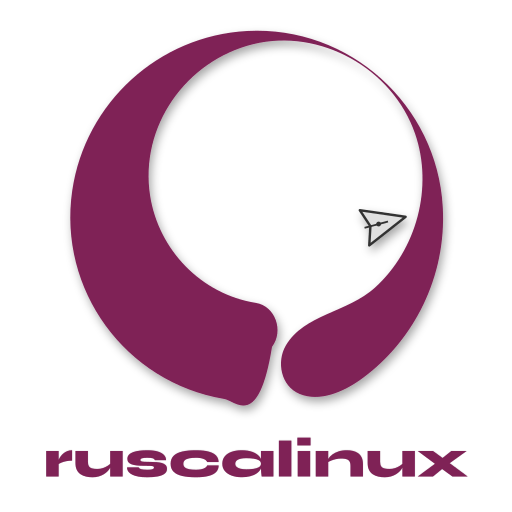

  

<h3 align="center">Free, complete, and ready to go.</h3>

  A Debian-based desktop distribution, refined and ready out of the box.

  <a href="https://www.ruscalinux.org">Website</a> ·
  <a href="https://sourceforge.net/projects/ruscalinux/">Download</a> ·
  <a href="https://github.com/ruscalinux/ruscalinux">Source code</a> ·
  <a href="https://www.youtube.com/@ruscalinux">YouTube</a>

  

**RuscaLinux** is built on Debian Stable and ships as a hybrid ISO: a full live system with its own installer. Everything you need is there from the first boot — a modern GNOME desktop on Wayland, LibreOffice, full multimedia, and more than 40 languages already in the base image.

**Stable by design.** RuscaLinux has no live repositories: your system stays exactly as you installed it, and you move forward by installing a new release.
